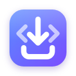
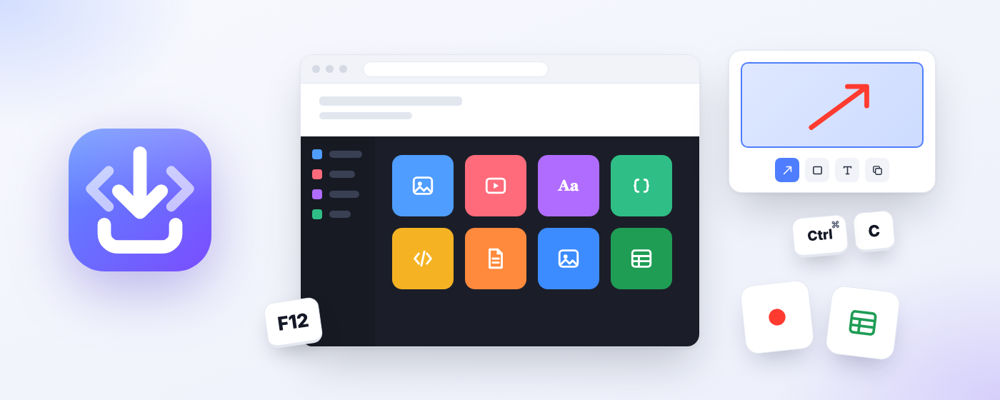
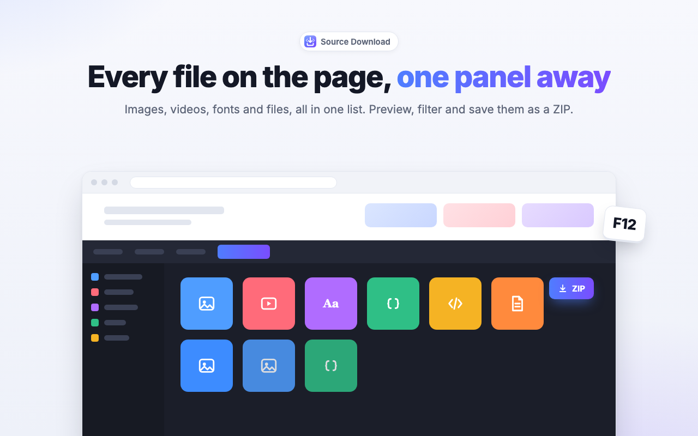
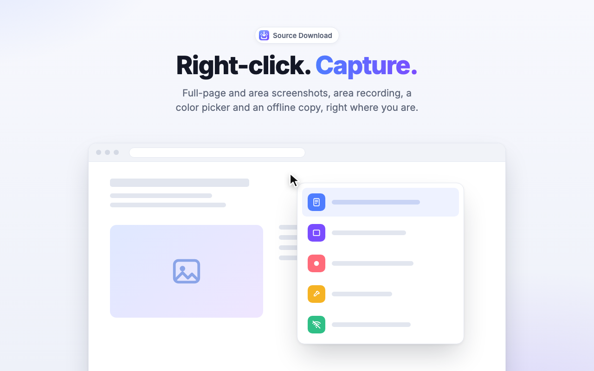
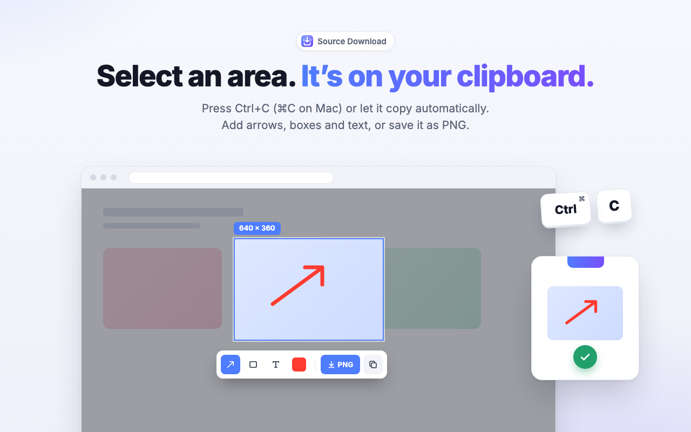
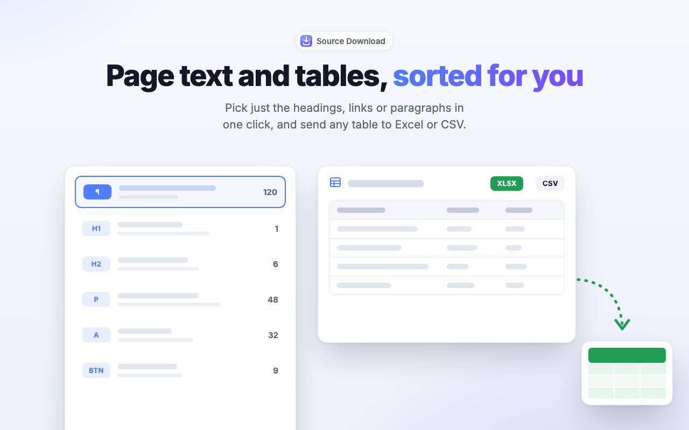
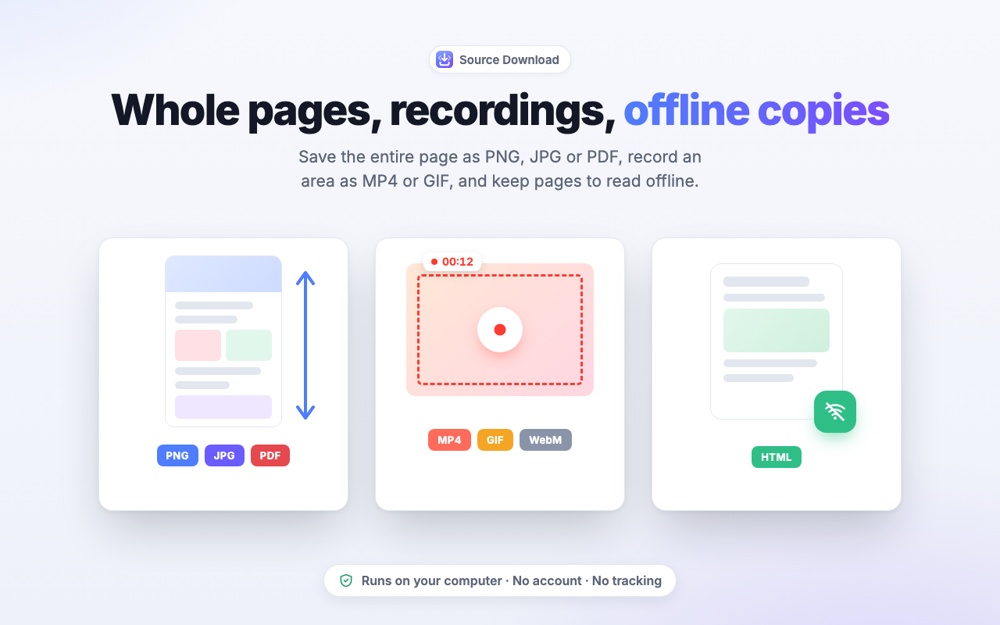

<p align="center">
  
</p>

<h1 align="center">Source Download</h1>

<p align="center">
  <a href="#"></a>
</p>

<p align="center">
  <a href="../../README.md"></a>
  <a href="README.tr.md"></a>
  <a href="README.de.md"></a>
  <a href="README.es.md"></a>
  <a href="README.fr.md"></a>
  <a href="README.it.md"></a>
  <a href="README.ja.md"></a>
  <a href="README.ko.md"></a>
  <a href="README.pt-BR.md"></a>
  <a href="README.ru.md"></a>
  <a href="README.zh-CN.md"></a>
  <a href="README.en-US.md"></a>
  <a href="README.en-GB.md"></a>
  <a href="README.es-419.md"></a>
  <a href="README.pt-PT.md"></a>
  <a href="README.zh-TW.md"></a>
  <a href="README.pl.md"></a>
  <a href="README.nl.md"></a>
  <a href="README.cs.md"></a>
  <a href="README.sv.md"></a>
  <a href="README.da.md"></a>
  <a href="README.fi.md"></a>
  <a href="README.no.md"></a>
  <a href="README.uk.md"></a>
  <a href="README.vi.md"></a>
  <a href="README.id.md"></a>
  <a href="README.th.md"></a>
  <a href="README.fil.md"></a>
  <a href="README.ms.md"></a>
  <a href="README.ar.md"></a>
  <a href="README.he.md"></a>
  <a href="README.fa.md"></a>
  <a href="README.el.md"></a>
  <a href="README.ro.md"></a>
  <a href="README.hu.md"></a>
  <a href="README.sk.md"></a>
  <a href="README.bg.md"></a>
  <a href="README.hr.md"></a>
  <a href="README.sr.md"></a>
  <a href="README.sl.md"></a>
  <a href="README.lt.md"></a>
  <a href="README.lv.md"></a>
  <a href="README.et.md"></a>
  <a href="README.ca.md"></a>
  <a href="README.bn.md"></a>
  <a href="README.hi.md"></a>
  <a href="README.ta.md"></a>
  <a href="README.te.md"></a>
  <a href="README.mr.md"></a>
  <a href="README.gu.md"></a>
  <a href="README.kn.md"></a>
  <a href="README.ml.md"></a>
  <a href="README.sw.md"></a>
  <a href="README.am.md"></a>
</p>

<p align="center">
  <em>வலைப்பக்கத்தின் படங்கள், ஐகான்கள், கோப்புகளைத் தனித்தனியாகவோ ஒரே ZIP-ஆகவோ சேமிக்கவும். முழுப் பக்கப் படம், பகுதிப் பதிவும் உண்டு.</em>
</p>

<p align="center">
  <a href="https://chromewebstore.google.com/detail/source-download/nockdgincmpfojabnhbofkddgcmnodpd"></a>
  
  
  
  
  
  
  <a href="../../LICENSE"></a>
  
  
</p>

---

## வணக்கம், நான் Turan Burak Yeşilyurt

பல ஆண்டுகளாக **வலை ஸ்கிராப்பிங்**, **தரவு பகுப்பாய்வு** மற்றும் **QA பணிப்பாய்வுகளுக்கான** தானியக்கங்களை உருவாக்கினேன். பிறகு SPA-கள் வலையை ஆக்கிரமித்தன — நானும் மீண்டும் மீண்டும் ஒரே தடையைச் சந்தித்தேன்: இறுதிப் பயனராக, திரையில் நீங்கள் *காணும்* விஷயங்களை எளிதாகப் பெற முடியாது; டெவலப்பராக, Chrome DevTools பகுதி பெரும்பாலும் போதாததாகவோ மிரட்சியாகவோ தோன்றும். அந்த ஏமாற்றமே **Source Download** ஐ நான் உருவாக்கக் காரணம்.

இது எனது **முதல் திறந்த மூலத் திட்டம்**, எனவே உங்கள் கருத்துகள் எனக்கு மிகவும் முக்கியம் — இதை மேம்படுத்துவதற்கான மிகப்பெரிய உந்துசக்தி அதுவே. மேலும், [**LinkedIn இல் என்னுடன் இணைய**](https://www.linkedin.com/in/turan-burak-yesilyurt/) அல்லது [**2run.dev**](https://2run.dev) ஐப் பார்வையிட மறக்காதீர்கள் — நீங்கள் இதை எப்படிப் பயன்படுத்துகிறீர்கள் என்பதையும், நாம் இணைந்து வேறு என்ன உருவாக்கலாம் என்பதையும் அறிய ஆவலாக இருக்கிறேன். மகிழுங்கள்!

> **Chrome Web Store:** [Chrome Web Store இலிருந்து Source Download ஐ நிறுவுங்கள்](https://chromewebstore.google.com/detail/source-download/nockdgincmpfojabnhbofkddgcmnodpd)

---

> **ஒரு ஒப்புதலும் திறந்த மூல உறுதிமொழியும்:** ஸ்டோரில் நீங்கள் காணும் கிட்டத்தட்ட ஒவ்வொரு "இந்தப் பக்கத்தின் ஆதாரங்களைப் பதிவிறக்கு" கருவியும், மூன்றாம் தரப்பு நூலகங்களின் குவியலைச் சுற்றிய ஒரு உறைதான். இது வேறுபட்டது. Source Download இன் ஒவ்வொரு பைட்டும் — **ZIP எழுதி**, **XLSX உருவாக்கி**, **HLS இணைப்பி**, **GIF என்கோடர்** மற்றும் **குறியீட்டு வடிவமைப்பிகள்** உட்பட — புதிதாகக் கையால் எழுதப்பட்டது. ஃப்ரேம்வொர்க்குகள் இல்லை, வெளிப்புறச் சார்புகள் இல்லை, பில்ட் படி இல்லை, டெலிமெட்ரி இல்லை. வெறும் vanilla JavaScript, ஒரே அமர்வில் படித்துத் தணிக்கை செய்யக்கூடியது.

---

## காட்சிச் சுற்றுலா மற்றும் முக்கிய தொகுதிகள்

<p align="center"></p>

<p align="center"></p>

<p align="center"></p>

<p align="center"></p>

<p align="center"></p>

<p align="center"></p>

---

Source Download இணைய உள்ளடக்கத்தைச் சேமிக்கும் கருவித்தொகுப்பு. இது Chrome டெவலப்பர் கருவிகளில் தனிக் கீற்றைச் சேர்க்கிறது. அங்கு தளம் ஏற்றிய அனைத்தும் வகைகளாக அடுக்கப்படும். முன்னோட்டம் பார்த்துத் தேவையானதை மட்டும் வைத்துக்கொள்ளலாம்.

## முக்கிய அம்சங்கள்
- ஒழுங்கான காட்சியகம்: ஒளிப்படங்கள், ஐகான்கள், எழுத்துருக்கள் நேரடி எண்ணிக்கை மற்றும் தேடல் பெட்டியுடன் தனித் தனிக் கீற்றுகளில் தோன்றும்.
- துல்லியமான வடிகட்டிகள்: குறிப்பிட்ட குறைந்தபட்ச அகலத்தை (எ.கா. 1200 px) விட அகலமானவற்றை மட்டும் காட்டலாம் அல்லது நகல்களை மறைக்கலாம்.
- உண்மையான முன்னோட்டம்: வரைகலையைப் பெரிதாக்கி ஊடகத்தை இயக்கலாம். எழுத்துரு மாதிரியையும் தொடரியல் வண்ணமிட்ட குறியீட்டையும் பார்க்கலாம்.
- ஒரே காப்பகம்: வேண்டியவற்றைக் குறித்து நேர்த்தியான கோப்புறை அமைப்புள்ள ஒரே ZIP-ஐப் பெறுங்கள். தோல்வியடைந்தவற்றை ஒரே கிளிக்கில் மீண்டும் முயலலாம்.
- முழுப் பக்கப் படம்: அனைத்தும் உருட்டப்பட்டு PNG, JPG அல்லது PDF ஆக இணைக்கப்படும். ஒரு பகுதியை மட்டும் தேர்ந்தெடுக்கவும் முடியும்.
- பகுதிப் பதிவு: தெரியும் ஒரு பகுதியை GIF, MP4 அல்லது WebM கிளிப்பாக மாற்றுங்கள்.
- அட்டவணையிலிருந்து விரிதாளுக்கு: நேரடி அட்டவணைகளை Excel அல்லது CSV-க்கு ஏற்றுமதி செய்யுங்கள், புதுப்பிக்கப்படும் அட்டவணைகளின் முந்தைய நிலைகளுடன்.
- ஆஃப்லைன் நகல்: இணையம் இல்லாமல் திறக்கும் ஒரே HTML ஆவணமாகத் தளத்தை வைத்திருங்கள்.
- வண்ணத் தேர்வி: தெரியும் எந்த வண்ணத்தையும் எடுத்து HEX, RGB அல்லது HSL ஆக நகலெடுங்கள்.

## தொடங்குவது எப்படி
1. நீங்கள் வேலை செய்ய விரும்பும் தளத்தைத் திறக்கவும்.
2. F12 அழுத்தவும் (Mac-இல் Option + Command + I), Source Download கீற்றைத் தேர்ந்தெடுக்கவும். தெரியவில்லை என்றால் கீற்றுப் பட்டையின் முடிவிலுள்ள » ஐக் கிளிக் செய்யவும்.
3. ஏற்றும்போது பலகத்தைத் திறந்தே வைத்திருங்கள், எதுவும் விடுபடாது.

திரைப்பிடிப்பு, பதிவு, வண்ணத் தேர்வி ஆகியவை வலது கிளிக் மெனுவிலும் நீட்டிப்புப் பொத்தானிலும் கிடைக்கும்.

## தனியுரிமை

அனைத்தும் உங்கள் கணினியிலேயே இயங்கும். கணக்கும் பகுப்பாய்வும் இல்லை, நீங்கள் சேமிப்பது எதுவும் உருவாக்குநருக்கு அனுப்பப்படாது. சேமித்தவை Chrome வழியாக வழக்கமான பதிவிறக்கக் கோப்புறைக்குச் செல்லும்.

வளங்களைக் கண்டறிந்து தன் பணிகளைச் செய்ய, நீங்கள் பார்வையிடும் தளங்களை அணுகும் அனுமதி நீட்டிப்புக்குத் தேவை.

பதிப்புரிமையையும் பயன்பாட்டு விதிமுறைகளையும் மதித்து, பயன்படுத்த அனுமதியுள்ள உள்ளடக்கத்தை மட்டும் வைத்துக்கொள்ளுங்கள்.

## பதிப்பு 1.17-இல் புதியவை
- மிகவும் இலகுவானது: ஓர் அம்சத்தைப் பயன்படுத்தும் வரை எதுவும் இயங்காது.
- ஆஃப்லைன் நகல்களில் இப்போது அனைத்து ஒளிப்படங்களும் பின்னணிகளும் எழுத்துருக்களும் உள்ளன.
- நீண்ட HD கிளிப்புகளிலும் GIF பதிவு நினைவக வரம்புக்குள் இருக்கும்.
- புதிய வரவேற்புப் பக்கம், நீட்டிப்புப் பொத்தானில் குறுக்குவழிகள்.

கேள்விகள் அல்லது சிக்கல்கள்: <https://github.com/turanburakyesilyurt/source-download/issues>

→ [PRIVACY.md](../../PRIVACY.md)

---

## நிறுவல் மற்றும் விரைவுத் தொடக்கம்

### முறை 1: Chrome Web Store இலிருந்து நேரடியாக நிறுவுதல் (பரிந்துரைக்கப்படுகிறது)
1. அதிகாரப்பூர்வ [Source Download Chrome Web Store பக்கத்தைப்](https://chromewebstore.google.com/detail/source-download/nockdgincmpfojabnhbofkddgcmnodpd) பாருங்கள்.
2. **Chrome இல் சேர்** என்பதைக் கிளிக் செய்து அனுமதிகளை வழங்குங்கள்.
3. Chrome DevTools ஐத் திறந்து (`F12` அல்லது `Ctrl+Shift+I` / macOS இல் `Cmd+Option+I`) **Source Download** தாவலைக் கிளிக் செய்யுங்கள், அல்லது பக்கத்தில் எங்கு வேண்டுமானாலும் வலது-கிளிக் செய்யுங்கள்.

### முறை 2: மூலத்திலிருந்து அன்பேக் செய்த நீட்டிப்பை ஏற்றுதல் (டெவலப்பர் பயன்முறை)
1. அதிகாரப்பூர்வ GitHub களஞ்சியத்தை குளோன் செய்யுங்கள்:
```bash
git clone https://github.com/turanburakyesilyurt/source-download.git
cd source-download
```
2. Google Chrome ஐத் திறந்து `chrome://extensions` க்குச் செல்லுங்கள்.
3. மேல் வலது மூலையில் உள்ள **டெவலப்பர் பயன்முறை** சுவிட்சை இயக்குங்கள்.
4. **அன்பேக் செய்ததை ஏற்று** என்பதைக் கிளிக் செய்து, குளோன் செய்த `source-download` திட்டக் கோப்புறையைத் தேர்ந்தெடுங்கள்.

---

## உரிமம்

[MIT உரிமத்தின்](../../LICENSE) கீழ் வெளியிடப்பட்டது. பதிப்புரிமை © Turan Burak Yeşilyurt. பயன்படுத்த, ஆய்வு செய்ய, ஃபோர்க் செய்ய இலவசம்.
